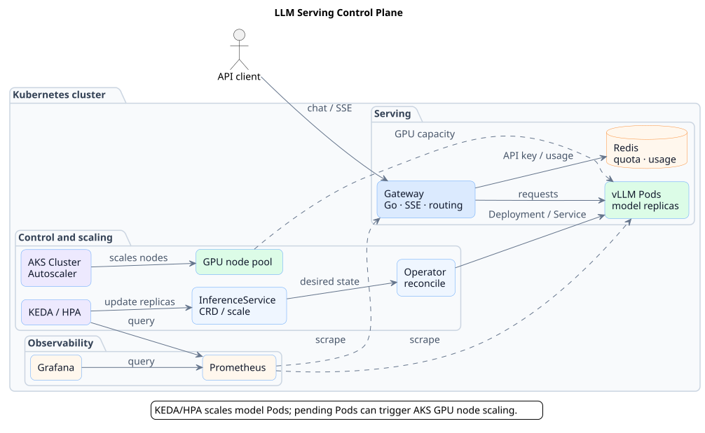
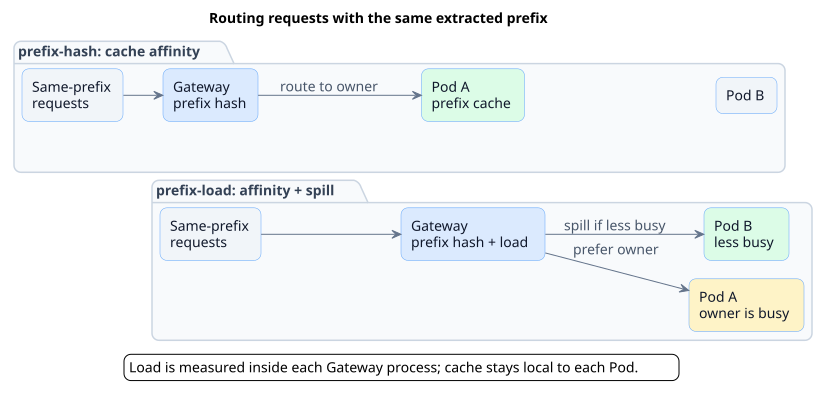
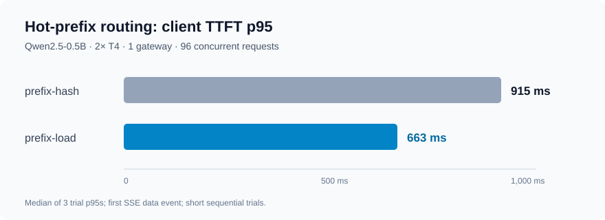
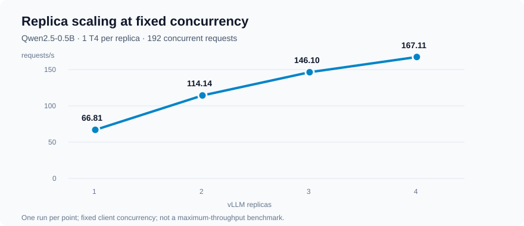
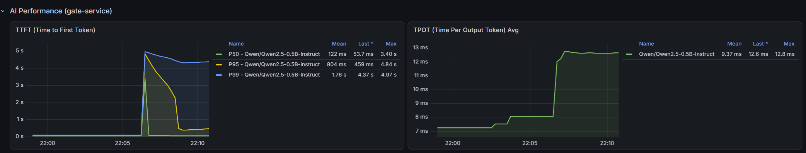

# LLM Serving Control Plane

[简体中文](README.zh-CN.md) | English

A Kubernetes-based control plane for running and scaling LLM inference services. The project combines a Go Operator with an inference gateway, usage accounting, autoscaling, and monitoring. It has been exercised with vLLM on Azure AKS and NVIDIA T4 GPUs.

## What it does

- **Model lifecycle**: an `InferenceService` CRD and Operator manage inference Deployments, Services, GPU resource profiles, and status conditions.
- **Inference gateway**: an OpenAI-compatible chat completions endpoint supports SSE streaming, authentication, rate limiting, and model-aware backend routing.
- **Usage accounting**: Redis-backed quota and usage records, idempotent billing, an outbox, and pending-usage settlement.
- **Autoscaling**: KEDA/HPA adjusts `InferenceService` replicas from vLLM metrics. On AKS, Cluster Autoscaler can add GPU nodes when Pods cannot be scheduled.
- **Observability**: Prometheus and Grafana collect and display gateway, vLLM, and GPU metrics, including request rate, TTFT, and GPU utilization.

## Architecture



The Gateway is deployed separately from the model Pods. KEDA scales serving Pods; AKS Cluster Autoscaler manages GPU nodes. [PlantUML source](docs/diagrams/architecture.puml).

## Quick start: CPU mock

This starts the Gateway, Redis, and a mock vLLM server. It does not need Kubernetes or a GPU. Docker Engine, Docker Compose v2.24.4 or newer, Bash, Python 3, and curl are required. Run the following from the repository root in one shell; ports `6379`, `8000`, and `8080` must be available. The demo uses an unauthenticated Redis and is for local testing only.

```bash
export JWT_SECRET='local-demo-only-change-me'
PROJECT="llm-serving-demo-$(date +%s)-$$"
OVERRIDE="$(mktemp)"

# Bind the demo to localhost and configure JWT authentication.
cat > "$OVERRIDE" <<'YAML'
services:
  redis:
    ports: !override
      - "127.0.0.1:6379:6379"
  mock-vllm:
    ports: !override
      - "127.0.0.1:8000:8000"
  gate-service:
    ports: !override
      - "127.0.0.1:8080:8080"
    environment:
      JWT_SECRET: ${JWT_SECRET}
YAML

docker compose -p "$PROJECT" -f docker-compose.yml -f "$OVERRIDE" \
  up -d --build redis mock-vllm
```

Wait until Redis returns `PONG` and the mock returns `OK`, then start the Gateway:

```bash
docker compose -p "$PROJECT" -f docker-compose.yml -f "$OVERRIDE" \
  exec -T redis redis-cli ping
curl -fsS http://127.0.0.1:8000/health

docker compose -p "$PROJECT" -f docker-compose.yml -f "$OVERRIDE" \
  up -d --build gate-service
curl -fsS http://127.0.0.1:8080/health
```

If a health check fails while a container is starting, retry it before continuing. Send an authenticated streaming request:

```bash
TOKEN="$(bash scripts/mint-jwt.sh readme-demo 3600)"
curl -fsS -N http://127.0.0.1:8080/v1/chat/completions \
  -H "Authorization: Bearer $TOKEN" \
  -H 'Content-Type: application/json' \
  --data '{"model":"mock-model","messages":[{"role":"user","content":"Say hello."}],"stream":true}'
```

The response contains SSE `data:` events, a final `usage` object, and `data: [DONE]`. The response is generated by a mock, not a model. The JWT secret above is for local testing only.

When finished, remove this demo's containers, network, and disposable data volumes:

```bash
docker compose -p "$PROJECT" -f docker-compose.yml -f "$OVERRIDE" down -v
rm -f "$OVERRIDE"
```

`down -v` deletes the demo's Redis data. Do not use this setup for persistent data. Building images may require network access.

## Selected experiments

These are controlled AKS experiments, not capacity guarantees. The TTFT figures below measure time to the first SSE data event.

### Prefix affinity under a hot prefix

The Gateway offers two prefix-aware routing strategies:

- **`prefix-hash`** hashes the model and an extracted context prefix to select an affinity replica, helping reuse its prefix cache.
- **`prefix-load`** prefers that replica; once its in-flight requests reach a threshold, it selects a least-loaded backend, which may be the same replica.



On two T4-backed Qwen2.5-0.5B replicas with one Gateway, 96 simultaneous requests shared an 8,000-character prefix. The median of three trial-level TTFT p95 values fell from **915 ms to 663 ms** with `prefix-load`, compared with `prefix-hash`.



The Gateway tracks in-flight load per process, not across Gateway replicas. The trials were short and the two strategies were run sequentially; results may differ under other workloads. [Conditions and per-trial results](docs/experiments/aks-t4-results.md#prefix-load-vs-prefix-hash).

### Replica scaling

In a separate 192-concurrency test, throughput rose from **66.81 to 167.11 requests/s** as Qwen2.5-0.5B replicas increased from one to four. Each replica used one T4; each point is one run.



The gains were not linear. The test used fixed client concurrency, so this is not a maximum-throughput benchmark. [Conditions and results](docs/experiments/aks-t4-results.md#replica-scaling).

### Autoscaling and rollout

An AKS exercise validated GPU node scale-out from zero to one and from one to two, together with a real vLLM request and usage accounting. A separate Gateway rollout under 50 concurrent streams recorded no 5xx responses or truncated streams; 37 TCP connection refusals were handled by client retries. [Experiment notes](docs/experiments/aks-t4-results.md#autoscaling-and-gateway-rollout).



*Grafana during an earlier Gateway restart exercise on AKS (2026-09-20, 32 concurrent requests). This screenshot is from a separate run, not the 50-concurrency rollout above.*

## Current design

- Backend discovery polls Kubernetes; a model can temporarily be unavailable while endpoints change.
- `prefix-load` uses per-Gateway in-flight counts. It does not share KV cache or global load state across replicas.
- Redis is a single instance in the validated setup. Its durability depends on deployment configuration; the local Compose setup is ephemeral.
- GPU node scale-from-zero is separate from request-driven model Pod scale-from-zero. The latter does not currently have a request activator.

## Repository map

| Directory | Contents |
|---|---|
| [`app/`](app/) | Gateway, middleware, routing, billing, and metrics |
| [`operator/`](operator/) | `InferenceService` API and controller |
| [`helm/`](helm/) | Operator and monitoring charts |
| [`experiments/azure/phase6/`](experiments/azure/phase6/) | AKS experiment manifests and load generators |
| [`scripts/`](scripts/) | Local helpers, experiment drivers, and evidence collection |
| [`terraform/`](terraform/) | Local and AWS infrastructure examples |

The [Operator guide](operator/README.md) contains deployment commands. Cloud deployment and GPU experiments incur costs.