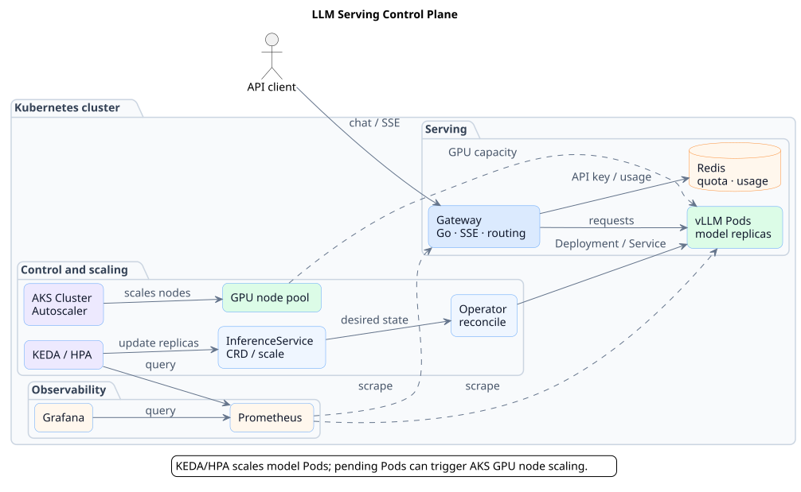
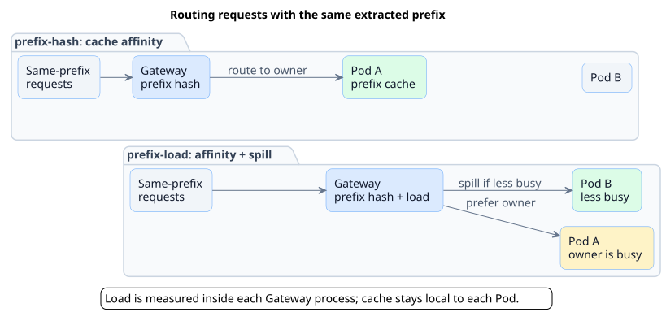
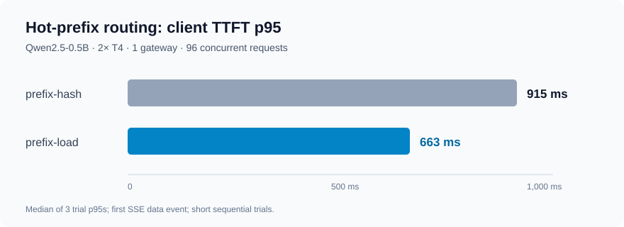
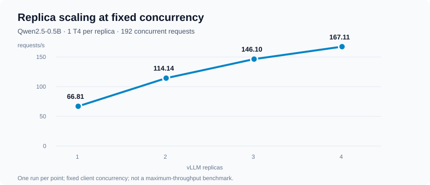
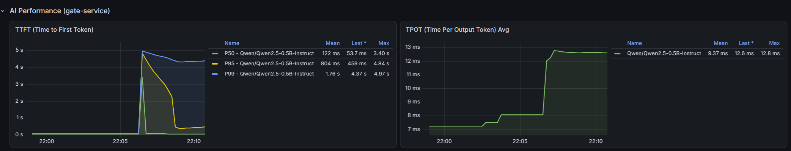

# LLM 推理服务控制平台

简体中文 | [English](README.md)

基于 Kubernetes 的大模型推理服务控制平台。项目使用 Go 开发 Operator 和推理网关，覆盖模型部署、用量计费、弹性伸缩和运行监控，并在 Azure AKS 和 NVIDIA T4 GPU 上验证了 vLLM 推理链路。

## 主要功能

- **模型生命周期**：通过 `InferenceService` CRD 和 Operator 管理推理 Deployment、Service、GPU 资源配置及状态。
- **推理网关**：提供 OpenAI 兼容的 chat completions 接口，支持 SSE 流式转发、鉴权、限流和按模型路由。
- **用量计费**：基于 Redis 记录配额和 Token 用量，支持幂等扣费、outbox 重试和待结算用量处理。
- **弹性伸缩**：KEDA/HPA 根据 vLLM 指标调整 `InferenceService` 副本；在 AKS 上，Pod 因 GPU 不足无法调度时，可由 Cluster Autoscaler 增加节点。
- **可观测性**：通过 Prometheus 和 Grafana 查看网关、vLLM 和 GPU 指标，包括请求速率、TTFT 和 GPU 利用率。

## 架构



Gateway 与模型 Pod 独立部署。KEDA 负责调整 Pod 副本，AKS Cluster Autoscaler 负责 GPU 节点供给。[PlantUML 源文件](docs/diagrams/architecture.puml)。

## 快速开始：CPU Mock

本示例启动 Gateway、Redis 和 Mock vLLM，不需要 Kubernetes 或 GPU。需要 Docker Engine、Docker Compose v2.24.4 或更高版本、Bash、Python 3 和 curl。请在仓库根目录的同一个 shell 中执行，确保 `6379`、`8000`、`8080` 端口可用。Redis 未启用认证，此配置仅供本地测试。

```bash
export JWT_SECRET='local-demo-only-change-me'
PROJECT="llm-serving-demo-$(date +%s)-$$"
OVERRIDE="$(mktemp)"

# 服务只监听本机，并配置 JWT 密钥。
cat > "$OVERRIDE" <<'YAML'
services:
  redis:
    ports: !override
      - "127.0.0.1:6379:6379"
  mock-vllm:
    ports: !override
      - "127.0.0.1:8000:8000"
  gate-service:
    ports: !override
      - "127.0.0.1:8080:8080"
    environment:
      JWT_SECRET: ${JWT_SECRET}
YAML

docker compose -p "$PROJECT" -f docker-compose.yml -f "$OVERRIDE" \
  up -d --build redis mock-vllm
```

确认 Redis 返回 `PONG`、Mock 返回 `OK` 后，再启动 Gateway：

```bash
docker compose -p "$PROJECT" -f docker-compose.yml -f "$OVERRIDE" \
  exec -T redis redis-cli ping
curl -fsS http://127.0.0.1:8000/health

docker compose -p "$PROJECT" -f docker-compose.yml -f "$OVERRIDE" \
  up -d --build gate-service
curl -fsS http://127.0.0.1:8080/health
```

如果容器仍在启动、健康检查暂时失败，稍后重试。随后发送带认证的流式请求：

```bash
TOKEN="$(bash scripts/mint-jwt.sh readme-demo 3600)"
curl -fsS -N http://127.0.0.1:8080/v1/chat/completions \
  -H "Authorization: Bearer $TOKEN" \
  -H 'Content-Type: application/json' \
  --data '{"model":"mock-model","messages":[{"role":"user","content":"Say hello."}],"stream":true}'
```

响应应包含 SSE `data:` 事件、末尾的 `usage` 和 `data: [DONE]`。内容由 Mock 生成，不代表真实模型推理。示例 JWT 密钥仅用于本地测试。

结束后清理本次演示的容器、网络和临时数据卷：

```bash
docker compose -p "$PROJECT" -f docker-compose.yml -f "$OVERRIDE" down -v
rm -f "$OVERRIDE"
```

`down -v` 会删除本次演示的 Redis 数据，此配置不适合持久化用途。首次构建镜像需要网络。

## 实验结果

以下结果来自特定条件下的 AKS 实验，不是通用容量保证。这里的 TTFT 按客户端收到第一个 SSE 数据事件计算。

### 热点前缀路由

Gateway 提供两种前缀路由策略：

- **`prefix-hash`**：根据模型名和提取的上下文前缀选择亲和副本，尽量复用该副本的 Prefix Cache。
- **`prefix-load`**：优先选择亲和副本；当其在途请求达到阈值时，选择负载最低的后端，该后端也可能仍是亲和副本。



在两张 T4、两个 Qwen2.5-0.5B 副本和一个 Gateway 上，以 96 个并发请求访问同一个 8,000 字符前缀。与 `prefix-hash` 对比，`prefix-load` 三次实验的 TTFT p95 中位数从 **915 ms 降至 663 ms**。



负载计数只在单个 Gateway 进程内生效；实验时间较短，两组策略按顺序运行，其他负载下结果可能不同。[实验条件和各次结果](docs/experiments/aks-t4-results.md#prefix-load-vs-prefix-hash)。

### 副本扩容

另一组 192 并发实验中，Qwen2.5-0.5B 从一个副本扩到四个副本时，吞吐从 **66.81 增至 167.11 请求/秒**。每个副本使用一张 T4，每档运行一次。



副本增加带来的收益并非线性；测试采用固定客户端并发，不代表系统最大吞吐。[实验条件和结果](docs/experiments/aks-t4-results.md#replica-scaling)。

### 弹性与发布演练

AKS 演练验证了 GPU 节点从零到一、从一到二的扩容，以及真实 vLLM 请求和用量入账。另一次 Gateway 滚动发布在 50 并发流式请求下没有出现 5xx 或流截断；期间有 37 次 TCP 连接拒绝，由客户端重试处理。[实验说明](docs/experiments/aks-t4-results.md#autoscaling-and-gateway-rollout)。



*Grafana 截图来自另一次 AKS Gateway 重启演练（2026-09-20，32 并发），与上面的 50 并发发布演练不是同一轮实验。*

## 当前设计

- Gateway 通过轮询发现 Kubernetes 后端，端点变化期间模型可能暂时不可用。
- `prefix-load` 只使用单个 Gateway 内的请求数，不提供跨副本 KV Cache 或全局负载共享。
- 已验证配置中的 Redis 是单实例；持久性取决于部署配置，本地 Compose 数据不会持久保留。
- GPU 节点从零扩容与模型 Pod 的请求唤醒是两件事；目前没有零副本模型的请求激活器。

## 目录

| 目录 | 内容 |
|---|---|
| [`app/`](app/) | Gateway、鉴权限流、路由、计费与指标 |
| [`operator/`](operator/) | `InferenceService` API 和控制器 |
| [`helm/`](helm/) | Operator 和监控 Chart |
| [`experiments/azure/phase6/`](experiments/azure/phase6/) | AKS 实验配置与负载生成器 |
| [`scripts/`](scripts/) | 本地工具、实验驱动与证据采集 |
| [`terraform/`](terraform/) | 本地和 AWS 基础设施示例 |

[Operator 指南](operator/README.md)包含部署命令。云上部署和 GPU 实验会产生费用。